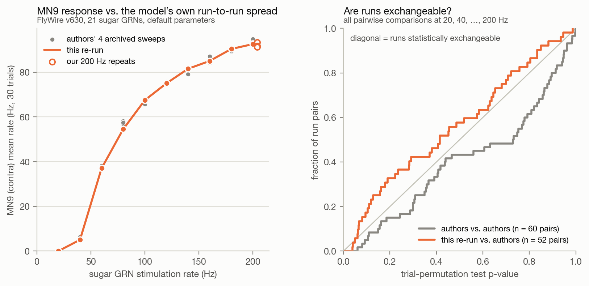
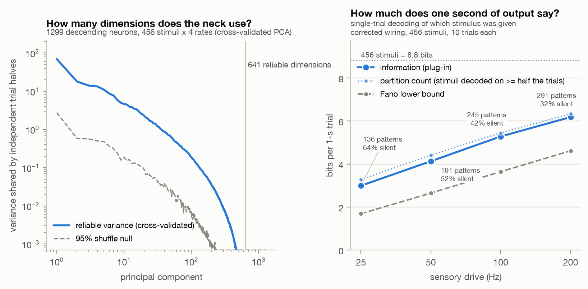
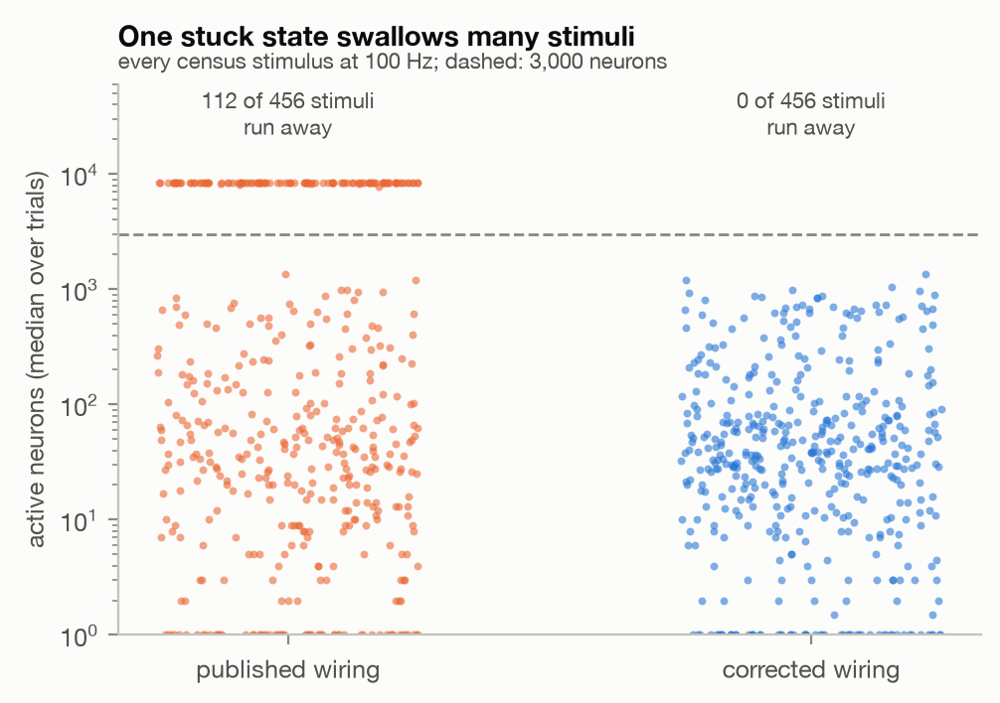
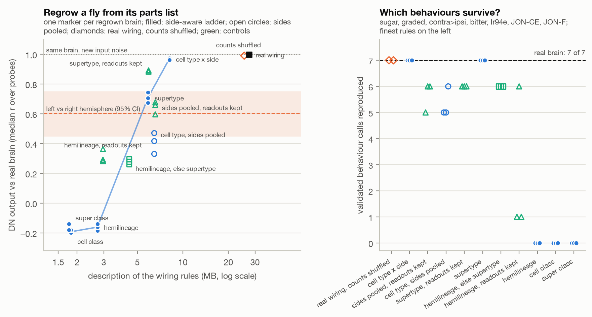

# Connectome Intelligence

[](#license)
[](#requirements)
[](#built-on)
[](#key-terms)

Experiments on a published whole-brain model of the fruit fly: an acceptance test for model copies, a census of the
brain's output, and regrowing the wiring from rules.

The model is the leaky integrate-and-fire simulation of the adult fruit-fly brain by [Shiu et al. (*Nature*
2024)](https://doi.org/10.1038/s41586-024-07763-9). It turns every neuron of the FlyWire electron-microscopy connectome
(about 139,000 in the current public release) into a simple spiking unit, connected exactly as reconstructed. We did
not build a new brain model, simulator or wiring diagram: everything here runs on the existing ones listed under
[Built on](#built-on). The three parts ask, in turn, how you can tell whether a copy of the model is faithful, what the
model sends to its body, and how much wiring detail its behaviour needs.

**What is ours:** the acceptance test, the census, the regrowth generator, the analyses and the cross-check, and the
results they produced; the code is in `stage1/`, `expression/`, `crosscheck/` and `fetch_data.py`. Each part below
separates what was already done by others from what is new here.

> [!NOTE]
> Every result describes the model, not real flies, and nothing here is peer-reviewed. Part 1 (the acceptance test)
> uses the wiring release the paper used (FlyWire v630). Parts 2 and 3 (the census and the regrowth) use the current
> public release (v783) with one community correction to the wiring, a deliberate deviation from the published model
> (see [Built on](#built-on) and [Limitations](#limitations)).

## Highlights

- **1. [An acceptance test for model copies](#1-an-acceptance-test-for-model-copies).** A strict pass/fail test that
  checks, trial by trial rather than on averages, whether a copy of the model (for example a port to faster hardware)
  is statistically indistinguishable from the original.
  - Run at three of the paper's 20 stimulation rates, it caught a copy with every synapse 3% weaker but passed one 1%
    weaker; the usual checks would have passed the 3% copy at the paper's main rates of 100 and 200 Hz.
  - We used it to check a fast Apple-Silicon port of the model (the MLX port) before relying on it for parts 2 and 3.
- **2. [A census of the brain's output](#2-a-census-of-the-brains-output).** We stimulated 228 kinds of sensory and
  visual neurons, one side at a time (456 stimuli, at four rates), and recorded all 1,299 descending neurons: the
  brain's only route to the nerve cord that runs the legs and wings.
  - At 100 Hz, 42% of stimuli evoke no spike in any descending neuron, and those that do are identified from a single
    trial 90% of the time.
  - On the published wiring at 100 Hz, 112 of the 456 stimuli throw the model into a runaway state of about 8,400
    active neurons, first described by Recluse/FLY-lab; the community correction removes it.
- **3. [Regrowing the wiring from rules](#3-regrowing-the-wiring-from-rules).** We sorted neurons into groups, kept how
  many connections run between each pair of groups and how strong they are, and how many connections each neuron has,
  and randomly reassigned which neuron in a group connects to which. We did this at five levels of detail, from cell
  type × side down to super class, plus controls (32 brains), and checked which behaviours and output patterns survive.
  - Rules by cell type and side pass all seven behaviour checks, and the responses of the 766 one-cell-per-side
    descending neurons to 46 probe stimuli correlate with the real brain's at r = 0.96 to 0.97 (median over probes).
    That is an easier test than it looks: at that level, 94% of these neurons' input synapses still come from real
    partners, while the other 533 descending neurons are individually scrambled (r 0.58 to 0.64).
  - Supertype rules pass only fragilely. Coarser rules lose both the behaviours and the output patterns. At the
    hemilineage level, the behaviour checks fail mostly because of how our generator groups neurons without a
    hemilineage label; grouping those by supertype brings back 6 of 7 checks, though not the output patterns.
- **[Cross-check in the original simulator](#cross-check-in-the-original-simulator).** Parts 2 and 3 ran on the fast
  port. On three conditions, including the runaway state and its correction, the port matches the authors' unchanged
  model code in Brian2 under the same whole-trial test as part 1; no census stimulus or regrown brain was itself run in
  Brian2.

## Contents

- [Built on](#built-on)
- [Key terms](#key-terms)
- [Getting started](#getting-started)
- [1. An acceptance test for model copies](#1-an-acceptance-test-for-model-copies)
- [2. A census of the brain's output](#2-a-census-of-the-brains-output)
- [3. Regrowing the wiring from rules](#3-regrowing-the-wiring-from-rules)
- [Cross-check in the original simulator](#cross-check-in-the-original-simulator)
- [Other findings](#other-findings)
- [Limitations](#limitations)
- [Reproducing the results](#reproducing-the-results)
- [Repository layout](#repository-layout)
- [Citation](#citation)
- [License](#license)

## Built on

**None of the following is ours:**

| What | Source |
|---|---|
| The whole-brain model, its code and the authors' archived simulation outputs | Shiu et al. 2024: [philshiu/Drosophila_brain_model](https://github.com/philshiu/Drosophila_brain_model) (MIT), archive [doi:10.17617/3.CZODIW](https://doi.org/10.17617/3.CZODIW) |
| The simulator the authors' code runs on | Brian2 ([Stimberg, Brette & Goodman 2019](https://doi.org/10.7554/eLife.47314)) |
| The wiring diagram and cell annotations | FlyWire ([Dorkenwald et al. 2024](https://pmc.ncbi.nlm.nih.gov/articles/PMC11446842/); Schlegel et al. 2024)<br>synapse predictions (Buhmann et al. 2021, with cleft scores from Heinrich et al. 2018)<br>transmitter predictions ([Eckstein et al. 2024](https://pmc.ncbi.nlm.nih.gov/articles/PMC11106717/))<br>[flywire_annotations](https://github.com/flyconnectome/flywire_annotations)<br>taste-neuron types ([Tastekin et al. 2026](https://doi.org/10.1016/j.cell.2026.08.016)) |
| The fast Apple-Silicon (MLX) copy of the model | [Kisame76/drosophila-brain-mlx](https://github.com/Kisame76/drosophila-brain-mlx) (MIT) |
| The wiring correction we use (all 429 antennal-lobe local neurons made inhibitory) | [suifei/flywire-fly-lab](https://github.com/suifei/flywire-fly-lab), after [Recluse/FLY-lab](https://github.com/Recluse/FLY-lab) (first description of the runaway state it removes; see part 2), [xiangdoz](https://github.com/xiangdoz/fly-connectome-attractor) and [cerebro-mosca](https://github.com/amthedev/cerebro-mosca) ([issue #11](https://github.com/philshiu/Drosophila_brain_model/issues/11)) |

Both code bases are included unmodified as git submodules, pinned to the commits we used. The neuron ID lists in
`stage1/neurons.py` (the paper's stimulus sets and MN9) are copied from the authors' `figures.ipynb`.

## Key terms

- **Descending neurons (DNs):** neurons that carry the brain's output through the neck to the ventral nerve cord, so
  "what the brain sends down its neck" means their activity. (A few motor neurons leave the brain directly, such as
  MN9, which extends the proboscis to feed.)
- **Stimulation rate (Hz):** stimulated neurons are made to fire at random times at this average rate, for one second.
  A neuron *recruited* by a stimulus is one that then fires at 1 Hz or more.
- **FlyWire v630 and v783:** two releases of the wiring diagram; the paper used v630, and v783 is the current one.
- **Published and corrected wiring:** a release as the authors' code ships it (v783 in parts 2 and 3), and v783 with
  the community correction above (all 429 antennal-lobe local neurons made inhibitory).
- **Groupings of neurons, from fine to coarse:** cell type (neurons with the same shape and wiring), supertype
  (similar cell types merged), hemilineage (neurons born from the same neural stem cell that share a developmental
  fate), cell class and super class (broad categories such as "central brain").

## Getting started

### Requirements

You need git, [uv](https://docs.astral.sh/uv/) and about 7 GB of free disk. We ran everything on macOS. The code uses
two Python environments:

| Environment | Python | Used for | Runs on |
|---|---|---|---|
| `.venv` | 3.10, with Brian2 2.5.1 | part 1's analyses and Brian2 simulations, the numbers sheet, `expression/wiring.py` and the regrowth generator | any machine |
| `.venv-mlx` | 3.13, with MLX | compiling the wiring for the MLX port ("packs"), and all MLX simulations and analyses | an Apple-Silicon Mac |

- The regrowth generator runs in `.venv` but hands each regrown wiring to `.venv-mlx` to compile, so it also needs an
  Apple-Silicon Mac.
- Each Brian2 worker needs about 2.2 GB of RAM.
- `fetch_data.py` and `expression/check_packs.py` need only Python's standard library.

### Installation

```bash
git clone --recurse-submodules https://github.com/nihalssingh/connectome-intelligence.git
cd connectome-intelligence

# .venv: Python 3.10 with Brian2 (any machine)
uv venv --python 3.10 .venv
uv pip install --python .venv/bin/python -r requirements-brian2.txt

# .venv-mlx: Python 3.13 with MLX (Apple-Silicon Mac only)
uv venv --python 3.13 .venv-mlx
uv pip install --python .venv-mlx/bin/python -r requirements-mlx.txt

# FlyWire annotations (pinned, SHA-256 checked) and the authors' archive (version 3)
python3 fetch_data.py
```

### Quick start

The stored results are included, so these two commands need no whole-brain simulation and no compiled wiring:

```bash
# Pass/fail guards on the acceptance test's statistics
.venv/bin/python -m pytest -q stage1/test_analysis.py

# Writes results/expression/numbers.md, the source of the numbers in parts 2 and 3
.venv/bin/python expression/numbers_sheet.py
```

The numbers sheet reads only stored result files, so it runs right after cloning, in either environment. The full
commands are under [Reproducing the results](#reproducing-the-results).

## 1. An acceptance test for model copies

The model is popular, and people port it to faster hardware. Ports are usually checked by correlating average firing
rates with the original, or by comparing one motor neuron. Neither tells you whether the port is actually the same
model.

### Approach

**The whole-trial test.** For the paper's sugar experiment (*Nature* Fig. 1c, called "Fig. 1D" in the authors' code
and archive: 21 taste neurons stimulated at 20 rates from 10 to 200 Hz), the authors archived 30 simulated one-second
trials per rate. For each rate we pool a copy's 30 trials with the authors' 30, shuffle which trial belongs to which
run thousands of times, and ask whether the real split looks unusual among the shuffles. Whole trials are shuffled, so
neurons that fire together stay together, and every active neuron (a few hundred) is tested at once. If the copy is the
same model, the split should look ordinary.

**The pass/fail rule.** `stage1/acceptance.py` turns this into a pass/fail check. A copy passes if all four of these
hold:

- the per-rate p-values look evenly spread between 0 and 1 (KS p > 0.01);
- no neuron differs after correction at any rate;
- MN9 stays within |z| < 3.5 at every rate;
- per-neuron mean rates correlate at r > 0.99 at every rate.

**The authors' repeat sweeps.** The archive also holds three more sugar-only sweeps of the same neurons at 10 of the
rates (the sugar-alone conditions of the paper's bitter, Ir94e and water experiments), so at those rates our runs can
be compared with four of the authors' runs, and theirs with each other.

### Results

| Check (20 rates, 30 trials each) | Our re-run of the original code | MLX port |
|---|:---:|:---:|
| Rates with permutation p < 0.05 (1 expected by chance) | 2 of 20 | 0 of 20 |
| Are the 20 p-values spread evenly between 0 and 1, as they should be? (KS test) | p = 0.62 | p = 0.61 |
| Neurons that differ after multiple-testing correction | 0 | 0 |
| Correlation of per-neuron mean rates, every rate | r > 0.996 | r > 0.996 |
| MN9, largest deviation over the 20 rates (difference in means over its standard error, \|z\|) | 2.8 | 2.1 |
| **Verdict** | **PASS** | **PASS** |

(`stage1/report.py` repeats the re-run comparison with 5,000 shuffles per rate and gets KS p = 0.55.)

- **It catches a wrong model that the usual checks miss.** We ran two deliberately wrong models at three of the 20
  rates (50, 100 and 200 Hz). With every synapse 3% weaker, the test fails clearly: p = 0.0005 at all three rates, the
  smallest value 2,000 shuffles can give, with about 200 neurons flagged at each. The usual checks would have passed
  that model at the paper's main rates of 100 and 200 Hz: per-neuron rates still correlate at r ≥ 0.995, and MN9 stays
  within |z| ≤ 1.7. Checking MN9 alone would catch it only at the lowest rate tested (z = −4.4 at 50 Hz).
- **Its limits are measured.** On synthetic pairs of 30-trial runs (`stage1/test_analysis.py`, run directly), the
  per-rate test gives p < 0.05 for 3% of pairs from one unchanged model (5% expected), for 90% of pairs in which one
  run has all rates 3% lower and for 100% in which 5% of neurons are 20% lower, but for only 11% with all rates 1%
  lower. The model with every synapse 1% weaker passed for a different reason: the per-rate test did flag two of its
  three rates (p = 0.016 and 0.008), but a check of whether three p-values are evenly spread has little power (KS p =
  0.04, above the 0.01 cut-off). We did not run that model at all 20 rates.
- **Against the authors' archived sweeps, our runs behave like independent repeats.** Testing each of our runs against
  each archived sweep at the same rate (52 pairs) gives p-values spread evenly between 0 and 1, as for independent
  repeats of one model (KS p = 0.26). The authors' four sweeps tested against each other (60 pairs) tend to agree more
  closely (median p 0.73 and none below 0.05, against 0.41 and 3 of 52 for ours), but only at 100 to 200 Hz (median
  0.83, against 0.53 for ours; at 20 to 80 Hz both are 0.33). Each sweep enters three of the six pairs at a rate, so
  these p-values are not independent. Averaged to one p-value per rate, they lie above 0.5 (the value expected for
  independent repeats) at all six rates from 100 to 200 Hz but below it at all four from 20 to 80 Hz, so across all 10
  rates the departure from 0.5 is not significant (Wilcoxon signed-rank test, p = 0.13). We found no shared seeds.
- **The fast port passes.** Against our Brian2 runs on v783 it is also indistinguishable (0 of 10 rates with p <
  0.05). One 30-trial experiment then takes about 10 seconds instead of about 2 minutes, which made parts 2 and 3
  possible on one laptop.



*Left: MN9 across stimulation rates in the authors' four archived sweeps (grey dots), our re-run (orange line) and
three extra runs of ours at 200 Hz (open circles). Right: for each kind of run pair, the share of pairs (y) whose
whole-trial test gives a p-value at or below x. Independent repeats of one model follow the diagonal; ours against the
authors' do, while the authors' sweeps against each other fall below it.*

### Prior work and what is new here

**Already done by others:**

- Reproducing sugar → MN9 (many re-runs).
- [FlyInfo](https://github.com/FuatKacar/FlyInfo) tests its port neuron by neuron against the archived rate tables,
  with pass thresholds, at 5 of the 20 rates plus other experiments from the paper.
- The MLX port ships its own pass/fail test against the authors' example outputs, and its reference engine matches
  Brian2 spike for spike on an 800-neuron sub-network.
- [flyonenomics](https://github.com/uguryildirim24/flyonenomics) wraps the original code with fixed seeds (the
  original sets none) and shows that every spike repeats exactly, on v783 at 150 Hz, under two Brian2 versions.
- An independent audit found the MLX port's spike counts in line with Brian2's
  ([Zhu 2026](https://doi.org/10.5281/zenodo.23299809)).

**New here:** the whole-trial test at all 20 rates, calibrated against the authors' own repeat sweeps and on synthetic
data, with deliberately wrong models as negative controls. Unlike FlyInfo's, it covers the sugar sweep only.

## 2. A census of the brain's output

How many stimuli reach the descending neurons at all, how well does the DN pattern identify the stimulus, and how do
the two halves of the brain compare?

### Approach

Using the fast port, which passed the test above, on v783 with the wiring correction, we drove each of 228 sensory and
visual cell types, on the left and on the right separately (456 stimuli), at four rates (25, 50, 100 and 200 Hz), for
10 one-second trials each: 18,240 simulated seconds. We recorded every DN.

### Results

Numbers are at 100 Hz unless stated.

- **Many inputs never reach the neck.** 42% of stimuli evoke no DN spike at all (64% at 25 Hz, 32% at 200 Hz). Silence
  tracks the size of the input as much as the sense: split each of the four largest senses into thirds by the driven
  cells' output synapses, and 56–86% of stimuli are silent in the third with the fewest, against 0–29% in the third
  with the most. Driving both sides at once, 34% of cell types still evoke nothing.
- **Those that do are identified from one trial 90% of the time** (by a nearest-centroid decoder, tested on trials it
  was not built from). Counting each stimulus identified on at least half its trials as its own pattern, and all
  silent stimuli as one shared pattern, gives 245 distinguishable output patterns. Because the silent pattern covers
  42% of stimuli, the patterns are far from equally common: one trial carries about 5.3 bits about which stimulus was
  given, not the 7.9 bits of 245 equally common patterns (other estimators give 4.97 to 5.45; telling all 456 stimuli
  apart would be 8.8 bits). At 200 Hz it is 6.2 bits.
- **At a single rate, the number of reliable dimensions is limited by the stimuli, not by the number of DNs.** A
  reliable dimension is a direction of joint DN activity along which the differences between stimuli repeat across two
  independent halves of the trials, beyond a shuffled control (cross-validated PCA, after [Stringer et al.
  2019](https://doi.org/10.1038/s41586-019-1346-5)). At each rate their number grows by about one per stimulus that
  reaches the neck and has not levelled off (231 at 100 Hz, far below the 611 DNs that reach 1 Hz at that rate).
  Pooled over all four rates it reaches 641, close to the 729 DNs that spike at all (696 reach 1 Hz at some rate), so
  there the number of DNs may also limit it; 90% of the reliable variance lies in 56 of these dimensions.
- **Most of that variance sits in a few dimensions, but not uniquely at the neck.** Pooled over all four rates, and
  leaving out 18 odour stimuli that tip into a separate state (see Limitations), the DN responses have a participation
  ratio of 10.4: an effective number of dimensions, which equals N when variance is spread evenly over N dimensions.
  Non-DN neurons that respond as broadly are just as concentrated (10.6 ± 0.6).
- **A few hub DNs answer to many inputs.** The left steering neuron DNa02 answers to 61 of 228 cell types, while 21%
  of active DNs answer to a single cell type.
- **In the model, the two halves of the brain answer differently.** Where both sides respond (117 cell types), the
  same cell type driven on the left or on the right shares 46% of its active DNs (r = 0.66), against 96% (r = 0.996)
  between two halves of the trials on one side; over all 144 compared types, r = 0.53. One trial tells which side was
  driven with over 80% accuracy for 92% of types, but the model's trial-to-trial noise is tiny, so that shows the
  differences are consistent, not that they are large. Part of them reflects how each side was reconstructed.
- **On the published wiring, smell, temperature and humidity input lock the brain into one state.** 112 of 456 stimuli
  (97 of the 106 single-odour-channel stimuli, all 14 temperature and humidity stimuli, and one taste stimulus) throw
  the published model into a runaway state of about 8,400 active neurons; the corrected wiring removes it.
  - In a 5-trial comparison at 100 Hz, stimuli that reach the DNs are identified from one trial 69% of the time on the
    published wiring, against 92% on the corrected wiring.
  - Over all 456 stimuli the totals change much less (223 against 244 distinguishable patterns, and 5.30 against 5.40
    bits by the pattern count), because the runaway turns many stimuli that are silent on the corrected wiring into
    loud but identical ones. On the published wiring, the estimator behind the 5.3 bits above gives an inflated 6.09
    bits, because 5 trials are too few to sample the confusions among its 112 near-identical runaway stimuli.
  - The seven behaviour checks of part 3 cannot see the runaway: they pass on the published wiring, because their
    stimuli never trigger it.



*Left: variance of the DN responses that repeats across independent halves of the trials, per principal component,
over all 456 stimuli × 4 rates, against a shuffled control. The vertical line marks the first 641 components, all
above the control (the count stops at the first one that is not); the plot stops at 1/100,000 of the first component's
variance, so the weakest of them are not drawn. Right: information per one-second trial about which stimulus was
given, at each rate.*



*Each dot is one stimulus at 100 Hz (median over trials); the dashed line marks 3,000 active neurons.*

### Prior work and what is new here

**Already done by others:**

- **Reading DNs out of connectome models under sensory drive.** [fly.ai](https://github.com/alextitonis/fly.ai)
  screened all 1,314 DNs of the male connectome against 20 stimuli, and several smaller projects did informal
  versions. [Walker et al. 2025](https://doi.org/10.1038/s41598-025-89088-9) ran four taste modalities through this
  model and read out second- and third-order neurons. Liessem et al. 2025 read out landing DNs under visual
  stimulation. A linear structural analogue,
  [dm_connectome_perturbome](https://github.com/guillermodeandajauregui/dm_connectome_perturbome), counts output
  dimensions and finds a specialist-to-generalist axis.
- **Stimulus strength.** Earlier work in this model followed single readouts as the rate rises: MN9 (Shiu et al.),
  oDN1 and BDN2 (Sapkal et al. 2024) and the giant fibre under LPLC2 input (fly-brain-sim); Shiu et al.'s
  Supplementary Table 1A also lists every neuron the sugar stimulus activates, DNs included, at all 20 rates. We found
  none that did this across many stimuli or sorted DN responses by how they grow.
- **The runaway state.** Recluse/FLY-lab described it first, xiangdoz showed that a single odour channel can trigger
  it, and [issue #11](https://github.com/philshiu/Drosophila_brain_model/issues/11) showed that right-side LB3 taste
  input triggers it through one mis-signed GABAergic neuron (il3LN6), which the paper's sugar neurons never activate;
  its thread added temperature input.
- **The two hemispheres.** Recluse/FLY-lab and suifei compared left- and right-side DN responses without an agreement
  statistic; [cerebro-mosca](https://github.com/amthedev/cerebro-mosca) then measured left/right agreement in this
  model by cell type (ρ 0.54 over 8,209 types, on its own corrected wiring);
  [Shibusawa 2026](https://github.com/r-shibusawa/connectome-fibration-symmetry) traced a left/right bias in one DN,
  in a model of the male connectome, to unequal input wiring;
  [drosophila-mb-lateralization](https://github.com/ydchen0806/drosophila-mb-lateralization) found a lateralized
  DNa02 gain in a FlyWire model; and [fly-with-a-real-brain](https://github.com/Jadog1122/fly-with-a-real-brain)
  noted that one antenna does not reach the grooming DN aDN1.

**New here:** the combination of a model copy that passed part 1's test, all 1,299 DNs, 456 stimuli × 4 rates × 10
trials, trial-noise floors and breadth-matched non-DN controls. That includes:

- how each DN's response grows with stimulus strength for 6,714 stimulus-DN pairs (in this model, which has no
  adaptation, 32% grow gradually, 17% switch on abruptly and the rest fall in between);
- a runaway count for every stimulus with the identification loss it causes (we did not check how much of the count
  Recluse/FLY-lab's screen already has);
- the left/right comparison on the DN layer with a noise floor and single-trial side decoding;
- the control showing that DNs are no more concentrated than comparable non-DN neurons (a negative result, in the
  model).

## 3. Regrowing the wiring from rules

How much of the wiring detail does the model need to keep its behaviour?

### Approach

Every brain here starts from the wiring of part 2 (v783 with the correction), and "real wiring" below means that
wiring.

**Regrowing a brain.** We sorted neurons into groups (for example "cell type, left side"). For every pair of groups we
kept how many connections run between them and how strong they are, and we kept how many connections each neuron has
(though not its total strength). Then we randomly reassigned which neuron in a group connects to which. The coarser the
groups, the less of the real wiring the rules pin down.

**What always stays fine-grained.** Two parts of the brain keep fine groups at every level. The periphery (sensory,
optic-lobe, motor and similar neurons) stays grouped by cell type × side, though it is still rewired within those
groups. The 208 neurons that the behaviour checks stimulate are each their own group, so their input and total output
are the same in every brain, though their individual targets change.

**Levels and controls.** We used five levels, from cell type × side down to super class, with three random brains per
level. We added a series that pools the two sides, four controls and two brains in which only synapse counts are
shuffled: 32 brains in all. Three controls use supertype, hemilineage or side-pooled rules but keep the readouts
(every DN, and the grooming neuron aBN1) in cell type × side groups ("readouts kept" in the figure below). The fourth
uses hemilineage rules but groups neurons without a hemilineage by supertype instead of a coarse catch-all
("hemilineage, else supertype"). Each control also draws its own random numbers, so it differs from its level in the
draw as well as in the rule.

**Scoring.** Each brain was scored in two ways:

- **Seven yes/no behaviour checks** after Shiu et al. Sugar drives MN9, and more strongly at higher rates. Bitter and
  Ir94e taste input (Ir94e is another class of taste neuron) each suppress it. The MN9 on the opposite side to the
  stimulus fires more than the one on the same side. Antennal JON-CE neurons drive the grooming neuron aBN1, and JON-F
  neurons do not.
- **"DN words":** each brain's DN responses to 46 probe stimuli at 100 Hz (23 census cell types, each driven on the
  left and on the right), correlated with the real brain's over those of the 766 one-cell-per-side DNs that respond in
  either brain (median over probes; a probe that is silent in only one brain scores 0). For scale, the real brain
  re-run with fresh noise scores 0.998, and the same probe driven on the left versus the right side of the real brain
  scores 0.60. Below 0 means the two brains respond with largely different DNs. Counting all 766 DNs, shared silence
  included, gives higher values in nearly the same order (for example 0.98 to 0.99 for cell type × side, 0.73 for left
  versus right; two controls swap places).

### Results

| Rules | Size | Behaviour checks passed | DN words (r) |
|---|:---:|:---:|:---:|
| Real wiring | 27.4 MB | 7 of 7 | 0.998 (re-run) |
| Cell type × side | 8.1 MB | 7 of 7, in all 3 brains | 0.96 to 0.97 |
| Supertype × side | 5.9 MB | 7 of 7, in all 3 brains | 0.68 to 0.74 |
| Hemilineage × side | 2.7 MB | none | lost (below 0) |
| Cell class or super class × side | 1.8 MB | none | lost (below 0) |

"MB" is the length of the rules in one simple code; the full wiring takes 27.4 MB.

- **Cell-type rules regrow a brain that behaves, but that is an easier test than it looks.** At this level each of the
  766 one-per-side DNs is its own group, so it receives exactly the real number of synapses from every presynaptic
  group; only which cells of that group supply them is reshuffled, and 94% of these DNs' input synapses still come
  from real partners (71% with the real count). Brain-wide, 61% of connections between central neurons land on real
  neuron pairs. The other 533 DNs, mostly from types with several cells per side, are individually scrambled (r 0.58
  to 0.64).
- **Supertype rules pass only fragilely.** The checks survive, but the amounts shift (MN9 at 50 Hz falls to 8.2 and
  3.1 Hz in two brains, against 17.3), and with the readouts kept ("supertype, readouts kept"), the opposite-side MN9
  check fails in all three brains.
- **The collapse at the hemilineage level is mostly our own catch-all rule.** 5,411 central neurons have no
  hemilineage label (most are listed as "putative primary"), so our generator puts them in coarse groups, and they
  supply 91% of MN9's input synapses. Grouping them by supertype instead ("hemilineage, else supertype") brings back 6
  of 7 checks, though not the DN words (r 0.26 to 0.30). So the checks barely test hemilineage rules as such.
- **Both sides matter.** Rules that pool the two hemispheres fail one or two checks in every brain.
- **Shuffling only synapse counts on the exact wiring keeps everything** (r 0.991), but 98% of MN9's input synapses
  keep their count anyway, against 61% of central synapses, so that control barely touches the MN9 pathway behind five
  of the seven checks. For aBN1 the share is 90% in one brain and 58% in the other, and both aBN1 checks still pass.



*Left: each regrown brain's DN words against the size of its rules; the shaded band is the real brain's left-versus-
right agreement. Right: behaviour checks passed by each brain.*

### Prior work and what is new here

**Already done by others:** rewiring ladders, and fidelity-against-size sweeps of this very model.

- [Guan et al. 2026](https://arxiv.org/abs/2609.38665) ran a six-step ladder of rewiring families in a nerve-cord rate
  model.
- [fly-granularity-sweep](https://github.com/dpl0xr/fly-granularity-sweep) coarse-grained this model at eight levels
  by merging the typed neurons (about 18% of all) and plotted fidelity against stored bytes; sugar → MN9 kept 79% of
  its response.
- Shiu et al.'s own shuffled-connectivity control (their Supplementary Table 1D) silences MN9, and [An
  2026](https://doi.org/10.64898/2026.09.19.752860) found that rewiring blind to cell type abolishes sugar → MN9, in
  line with our coarsest levels, so part of our answer was predictable; An 2026 also showed that one readout is a weak
  test.
- Our count shuffle follows the within-type weight shuffle of [Shibusawa
  2026](https://github.com/r-shibusawa/connectome-fibration-symmetry), which pooled the two hemispheres and broke a
  left/right bias in one DN; ours keeps the hemispheres apart, so the two test different things.
- [Jason103J](https://github.com/Jason103J/connectome-compression) coded FlyWire's ≥ 5-synapse wiring losslessly in
  4.68 MB with a block model by cell type and hemisphere, and scored pruned versions in a spiking model after Shiu et
  al. [Liu et al. 2026](https://doi.org/10.5281/zenodo.23088621) found that a block model by cell type and side
  explains 42–71% of the connectivity.
- cerebro-mosca had already used the agreement between the two hemispheres as a within-animal yardstick.

**New here:** the combination of a whole-brain, neuron-level ladder of side-aware rules with controls, in a model copy
that passed part 1's test, scored on behaviour and on DN output against rule size, with the two hemispheres as a
yardstick.

## Cross-check in the original simulator

Parts 2 and 3 ran on the fast port, which part 1 tested on the sugar experiment only. So we ran three conditions that
test the runaway and the correction with the authors' unchanged model code in Brian2, and compared the two simulators
with the same whole-trial test (`crosscheck/`; FlyWire v783):

| Condition | Active neurons per trial, Brian2 / MLX (median) | Whole-trial test | Neurons that differ | Rate correlation |
|---|:---:|:---:|:---:|:---:|
| The paper's 21 sugar neurons, 100 Hz, corrected wiring, 30 trials | 334 / 334 | p = 0.82 | 0 of 415 | r = 0.9997 |
| All 24 LB3b and LB3c taste neurons on FlyWire's right side, 150 Hz, published wiring, 10 trials | 8,418 / 8,421 (runaway) | p = 0.69 | 0 of 8,881 | r = 0.9999 |
| The same, corrected wiring, 10 trials | 196 / 194 | p = 0.54 | 0 of 294 | r = 0.9993 |

None of the 456 census stimuli and none of the regrown brains was itself run in Brian2. The Brian2 runs are not seeded,
so a re-run gives slightly different numbers.

**Already done by others:** the runaway condition is a narrower version of the case reported in
[issue #11](https://github.com/philshiu/Drosophila_brain_model/issues/11), which drove all of FlyWire's right-side LB3
taste neurons at 150 Hz (more than twice our 24 LB3b and LB3c cells). There the issue's author showed that making
il3LN6 alone inhibitory removes the runaway, and the flyonenomics author reproduced both results in the authors' Brian2
code with 30 seeded trials (about 8,700 active neurons, and 433 with il3LN6 inhibitory); xiangdoz also reproduced the
runaway in Brian2. Because the stimulus differs, those counts are not directly comparable with the table's.

**New here:** the fast port matches Brian2 in that state, and the full correction, which includes il3LN6, removes it
in both simulators.

## Other findings

### Command neurons: a partial reproduction of Braun et al. 2024

Braun et al. (*Nature* 2024) switched on one type of "command" DN at a time, imaged which other DNs it recruited, and
found DNp09 > aDN2 > MDN. They imaged only some of the DNs of the gnathal ganglia (GNG), so we count among the 841 DNs
that their connectome comparison treats as GNG DNs, a superset of the imaged cells. Among these GNG DNs:

- **MDN recruits the fewest** at 100 and 200 Hz, as they found.
- **aDN2 recruits more than DNp09 at every rate** with the 1 Hz criterion. The 95% intervals do not overlap at 50 and
  100 Hz (9 vs 6, and 16 vs 12), share one value at 25 Hz (5 vs 3; 4–5 and 3–4, so at most a tie) and overlap at
  200 Hz (24 vs 21; 24–25 and 18–25).
- **Only at 200 Hz could DNp09 lead.** With a 0.5 Hz criterion it does (28 vs 25), the only one of 12 combinations of
  rate and criterion where it does (with that criterion the two tie at 100 Hz, 16 vs 16). So on this stand-in the
  model does not reproduce their DNp09 > aDN2, except possibly at the strongest drive.

Counting all DNs, their order appears (33 > 25 > 11 at 200 Hz), but only through 12 non-GNG DNs that DNp09 recruits,
which they did not image.

As Braun et al. argued, recruitment follows how many other DNs each command neuron contacts directly with at least 5
synapses. Across the 12 sets we drove (11 of their 12, plus the giant fibre), the model's GNG recruitment at 200 Hz
correlates with these counts, recounted on v783, at Spearman 0.75. So this comparison is a weak test of the dynamics.

**Already done by others:** driving command DNs in this model. [Sapkal et al.
2024](https://doi.org/10.1038/s41586-024-07854-7) used it for DNp09, and
[fly-brain-sim](https://github.com/dhruvagrawat/fly-brain-sim) found DNp09 > giant fibre > MDN in total active
neurons.

**New here:** recruitment for 11 of Braun et al.'s 12 sets plus the giant fibre, over all DNs and over the GNG DNs, at
four rates with confidence intervals.

### FlyWire v630 versus v783

Moving from the paper's FlyWire v630 to v783 leaves MN9 within 2.7 Hz at each of the 10 rates compared (20 to
200 Hz), but the rest of the network would not pass part 1's test as the same model. In each release about 15% of
active neurons are not active under the same ID in the other, mostly because their IDs changed, and are left out.
Among the rest, neurons differ after correction at 5 of the 10 rates (one each at 40, 140 and 160 Hz, 9 at 180 Hz and
4 at 200 Hz), and the whole-trial test gives p = 0.001 at 180 Hz. So v783 stands in for v630 on MN9, not neuron by
neuron.

### Taste-neuron typing

Under the official v3.2.0 cell types (after Tastekin et al.), only 12 of the paper's 21 "sugar" neurons are
sugar-typed; the other 9 are LB3d and LB4b cells.

**Already done by others:** that breakdown. The [v3.2.0 release
notes](https://github.com/flyconnectome/flywire_annotations/releases/tag/v3.2.0) warn that the old sugar/water class
also contained LB3a and LB3d cells, and community projects had posted the breakdown
([ask-the-fly](https://github.com/Felix471/ask-the-fly/blob/main/docs/cell_set_crosscheck.md) first, for a related
23-cell set; then [FlyBrainLab](https://github.com/valleebo/FlyBrainLab/blob/main/flylab/atlas.py),
[ad3002/flylab](https://github.com/ad3002/flylab/blob/main/docs/v3_interpretation.md) and others). That the non-sugar
LB3d cells drive MN9 was reported first by ask-the-fly, then by
[flymsg](https://github.com/gianlucamazza/flymsg/blob/main/docs/comparison.md), which split the cells by wiring rather
than by type.

**New here:** how the two official subsets drive MN9 on v783: 42.2 Hz for the 12 and 6.8 Hz for the 9, at 100 Hz.

As a consistency check, all 33 sugar-typed neurons on the stimulated side (FlyWire's left) give 73.7 Hz, within 1 Hz
of [ask-the-fly](https://github.com/Felix471/ask-the-fly/blob/main/docs/salt_and_refreeze.md)'s independent run.

### Pitfalls for anyone re-running the model

**Already documented by others:**

- The model repository's left/right labels are mirrored relative to FlyWire's corrected annotations, because the
  electron-microscopy volume was left/right inverted ([FlyWire FAQ](https://codex.flywire.ai/faq); also noted by
  Walker et al. 2025), so select neurons by ID.
- The example notebook's output `results/example/sugarR.parquet` is a 200 Hz run, while `model.py` defaults to 150 Hz
  (noted by the MLX port and [sparx](https://github.com/AshishKumar4/sparx/blob/main/docs/fidelity.md)).

**New here:**

- The plotted means in *Nature* Fig. 1c at 40 to 100 Hz sit below the archived values (read off the figure).
- The example notebook calls the GABAergic neuron CB0248 "sugar-sensing".

## Limitations

- **A model, not a fly.** Point neurons with no gap junctions, neuromodulation, plasticity or adaptation, and
  predicted transmitter signs. Sugar → MN9 is what the model's single free parameter was tuned to, so reproducing it
  shows the code is faithful, not that the biology is right. Shiu et al. tested the model against flies mainly in
  feeding and grooming circuits, so its DN output for other senses, such as vision and smell, is a prediction. We
  compared no census result with real DN recordings, apart from a few known pathways and the partial command-neuron
  check.
- **Corrected wiring.** Parts 2 and 3 use v783 with all 429 antennal-lobe local neurons made inhibitory. The published
  model makes 166 of them excitatory. For 104 of those, the correction goes against the FlyWire annotations, which
  call them cholinergic: for 71 that call is the transmitter prediction, and for the other 33 a literature label
  (their predictions say dopaminergic or serotonergic, which the model also treats as excitatory). Most antennal-lobe
  local neurons are GABA- or glutamatergic (inhibitory there), but real flies also have some excitatory, cholinergic
  ones. A milder version that keeps those 104 as published still recruited about 2,300 to 2,500 neurons for
  temperature, humidity and all-odour input. The odour, temperature and humidity results depend on this choice.
- **A smaller state on the corrected wiring.** On the corrected wiring, 18 odour stimuli still tip into a smaller state
  of about 500 to 1,150 neurons. They are flagged; without them, identification gives 5.15 bits and 233 patterns at
  100 Hz, and 624 reliable dimensions across all rates. With them, the participation ratio is 10.1, against 9.7 ± 0.6
  for matched non-DN neurons.
- **One simulator for most results.** Parts 2 and 3 ran on the MLX port. It passed part 1's test on the sugar
  experiment and agreed with the original simulator on the three conditions above; no census stimulus or regrown brain
  was run in Brian2.
- **Crude stimuli.** Whole cell types driven with random spikes at fixed rates for one second, from rest.
  Photoreceptors never reach the DNs; that is an artefact of how the model signs their transmitter.
- **Estimates, not properties of the neck.** The bits and dimensions depend on this stimulus set and decoder, and the
  dimension count never levelled off at a single rate.
- **Hemispheres.** There is one connectome, and the two sides were reconstructed with different completeness (some
  sensory cell types have 4 to 17 times more output synapses on one side).
- **Regrowth.** Three brains per level. The behaviour checks are one-sided thresholds that pass quantitative shifts,
  and like the probes, each of which drives a whole cell type on one side, they are blind to structure within a cell
  type. Regrowth scrambles such structure at every level, for example the optic lobe's map of visual space: only 9% of
  optic-lobe connections land on real neuron pairs. Where the transition between supertype and hemilineage falls is
  not pinned down. The megabyte figures use a simple code, so only their order and rough ratios mean something; a
  structured code of the real wiring can be far smaller (see Jason103J above).
- **No external review.** Nothing here is peer-reviewed. All checks were run by us, with AI assistance.

## Reproducing the results

The stored outputs are included, so re-running any of this is optional. The environments are set up under
[Getting started](#getting-started).

### Part 1

The code is in `stage1/`. The stored spike files are included, so re-simulating is optional:

```bash
# Re-measure the test's false-positive rate and power (a few minutes)
.venv/bin/python stage1/test_analysis.py

# The acceptance test on our re-run of the original code: PASS
# (likewise for mlx_v630, v630_wsyn0.97 (FAIL) and v630_wsyn0.99)
.venv/bin/python stage1/acceptance.py results/stage1/runs/v630 \
    --json results/stage1/acceptance_v630.json

# The remaining part 1 analyses
.venv/bin/python stage1/report.py
.venv/bin/python stage1/replicates.py
.venv/bin/python stage1/variants.py

# MLX against Brian2 on v783, from the stored runs
.venv/bin/python expression/validate_v783.py
```

### Parts 2 and 3

The code is in `expression/`, named for what the brain expresses through its output. The analyses read compiled copies
of each wiring ("packs", about 4 GB), which are rebuilt rather than stored. There are 36: the published v630 and v783
wirings, the corrected wiring, a milder correction (`v783_alfix_ach`, used only by `expression/runaway_check.py`) and
the 32 regrown brains. Their SHA-256 hashes are in `data/pack_manifests/`; on our machine a rebuild from a fresh clone
reproduced all 36 exactly. (The manifests' "dataset" field is the port's default label; ignore it. The smaller state
that 18 odour stimuli still reach on the corrected wiring is called "ignition" in the code and in the corrected-wiring
result files; in the single-rate published-wiring file the same key lists the 112 runaway stimuli.)

```bash
M=.venv-mlx/bin/python

# The corrected wiring tables (also read by the Brian2 cross-check below)
.venv/bin/python expression/wiring.py alfix_all alfix_ach

# Compile the packs: the published v630 and v783 wirings and the two corrected ones
cd external/drosophila-brain-mlx
P=../../.venv-mlx/bin/python
$P -m lif.compile_pack \
    --completeness ../Drosophila_brain_model/2023_03_23_completeness_630_final.csv \
    --connectivity ../Drosophila_brain_model/2023_03_23_connectivity_630_final.parquet \
    --out data/pack/v630
$P -m lif.compile_pack \
    --completeness ../Drosophila_brain_model/Completeness_783.csv \
    --connectivity ../Drosophila_brain_model/Connectivity_783.parquet \
    --out data/pack/v783
for v in alfix_all alfix_ach; do
  $P -m lif.compile_pack \
      --completeness ../../data/wiring/v783_$v/Completeness_783.csv \
      --connectivity ../../data/wiring/v783_$v/Connectivity_783.parquet \
      --out data/pack/v783_$v
done
cd ../..

# The 30 regrown brains (~1 min each, CPU), then the 2 count-shuffled brains
.venv/bin/python expression/regrow.py
.venv/bin/python expression/regrow.py wshuffle type_x_side 0,1

# Compare all 36 packs with the stored hashes
python3 expression/check_packs.py

# The analyses, the numbers sheet and the figures
$M expression/analyze.py v783_alfix_all
$M expression/analyze.py v783_published100
for s in rank_saturation mirror_brain dictionary braun_baseline robustness; do
  $M expression/$s.py v783_alfix_all
done
$M expression/compress_analysis.py
$M expression/compress_checks.py
$M expression/numbers_sheet.py
$M expression/figures_expr.py
```

### Re-running the simulations

Every stored simulation comes from one of the commands below. The MLX runs need Apple Silicon and are seeded: on our
machine a re-run reproduced the stored spike counts exactly. The Brian2 runs are not seeded. Most scripts skip
conditions whose output files exist, so move those aside to re-simulate.

```bash
M=.venv-mlx/bin/python

# Part 1 in Brian2 (the first command takes about 1 h)
.venv/bin/python stage1/run_reference.py --dataset 630 \
    --group fig1d silencing replicates --n-proc 6
.venv/bin/python stage1/run_reference.py --dataset 630 \
    --group control_rates --w-syn-scale 0.97          # then again with 0.99
.venv/bin/python stage1/run_reference.py --dataset 783 --group archived_freqs grn_classes

# Part 1 with MLX
$M stage1/run_mlx.py                                  # -> results/stage1/runs/mlx_v630
$M stage1/run_mlx.py --pack external/drosophila-brain-mlx/data/pack/v783 --v783 \
    --freqs 20 40 60 80 100 120 140 160 180 200 --out results/stage1/runs/mlx_v783

# The census (~2 h), the published wiring (100 Hz, 5 trials) and both sides at once
$M expression/census.py --variant v783_alfix_all
$M expression/census.py --variant v783 --doses 100 --trials 5 --tag _published100
$M expression/census.py --variant v783_alfix_all --bilateral --tag _bilateral

# Trial-level re-run read by mirror_brain.py, and command-neuron recruitment
$M expression/mirror_trials.py v783_alfix_all
$M expression/braun.py v783_alfix_all

# Behaviour checks and DN words on the corrected and published wiring,
# then the independent re-run behind the 0.998
$M expression/battery.py v783_alfix_all,v783
$M expression/battery.py v783_alfix_all 500

# One regrown brain (a few minutes); likewise every regrow_* pack
$M expression/battery.py regrow_type_x_side_s0

# The runaway check on the published, corrected and milder-corrected wiring
$M expression/runaway_check.py v783 v783_alfix_all v783_alfix_ach

# The cross-check (the Brian2 run reads the tables from expression/wiring.py)
.venv/bin/python crosscheck/run.py --engine brian2
$M crosscheck/run.py --engine mlx
.venv/bin/python crosscheck/compare.py
```

## Repository layout

| Path | Contents |
|---|---|
| `stage1/` | Part 1: acceptance test, statistics, Brian2 and MLX runners, archive fetcher, figures |
| `expression/` | Parts 2 and 3: census, analyses, wiring variants, regrowth, behaviour checks, figures |
| `crosscheck/` | The same conditions in both simulators, and their comparison |
| `results/` | Every stored output: spike files, census counts, analysis results, figures |
| `data/` | Pack hashes, regrowth statistics, the paper's stimulus sets; downloaded inputs land here too |
| `external/` | The reference model and the MLX port, unmodified submodules at pinned commits |
| `fetch_data.py` | Downloads the third-party inputs that are not stored here |
| `requirements-*.txt` | Pinned packages for the two Python environments |

## Citation

Please cite the sources of whatever you use:

- **The model:** [Shiu et al. 2024](https://doi.org/10.1038/s41586-024-07763-9).
- **The fast port:** its authors ([Kisame76/drosophila-brain-mlx](https://github.com/Kisame76/drosophila-brain-mlx)).
- **The stored results**, which derive from FlyWire data: Dorkenwald et al. 2024 and Schlegel et al. 2024, as the
  [FlyWire guidelines](https://flywire.ai/guidelines) ask, plus the papers behind the parts you use (for the connection
  counts, Buhmann et al. 2021 and Heinrich et al. 2018).

## License

- **Code:** our code is MIT-licensed (see [LICENSE](LICENSE)); the two submodules carry their own MIT licences.
- **Data:** the stored results derive from FlyWire data. The [FlyWire guidelines](https://flywire.ai/guidelines) state
  CC BY-NC 4.0, while the Zenodo v783 release states CC BY 4.0, so treat reuse as non-commercial unless clarified.
